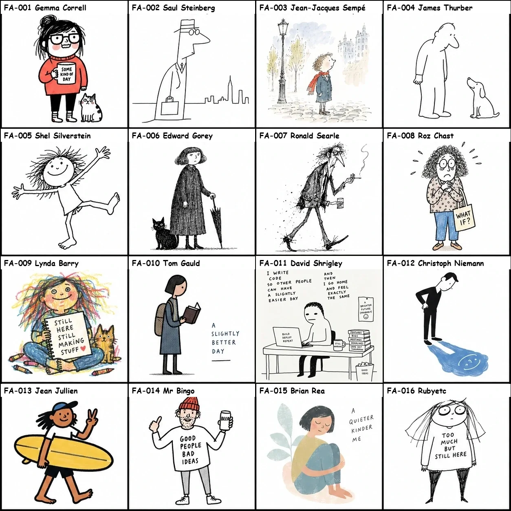
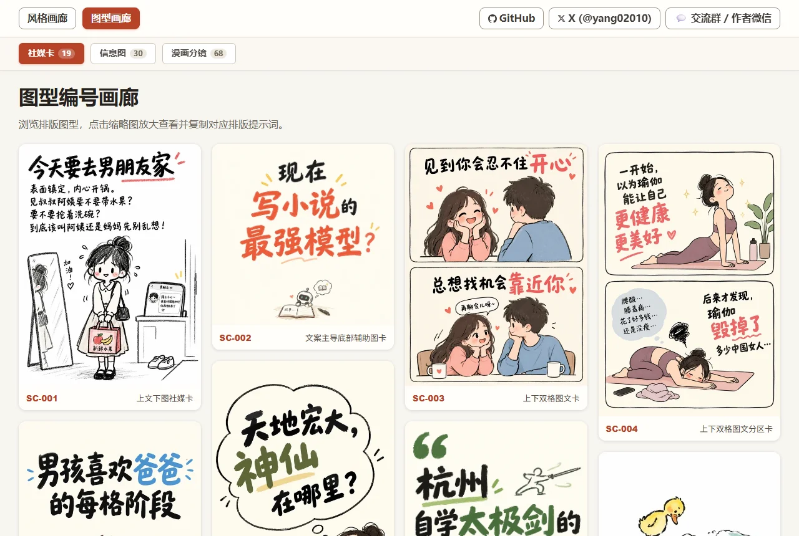
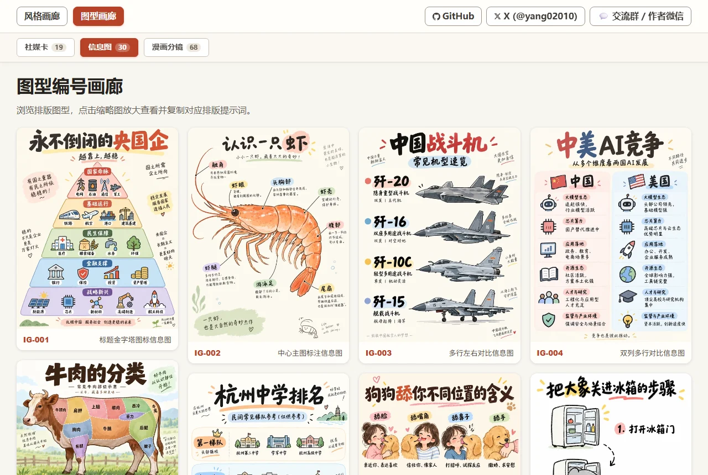
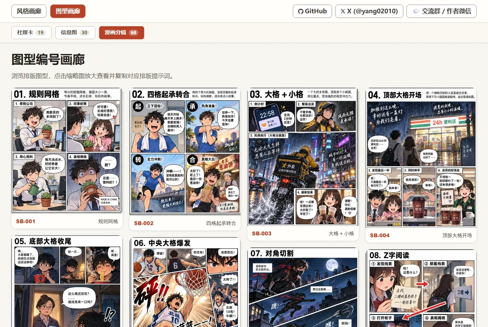
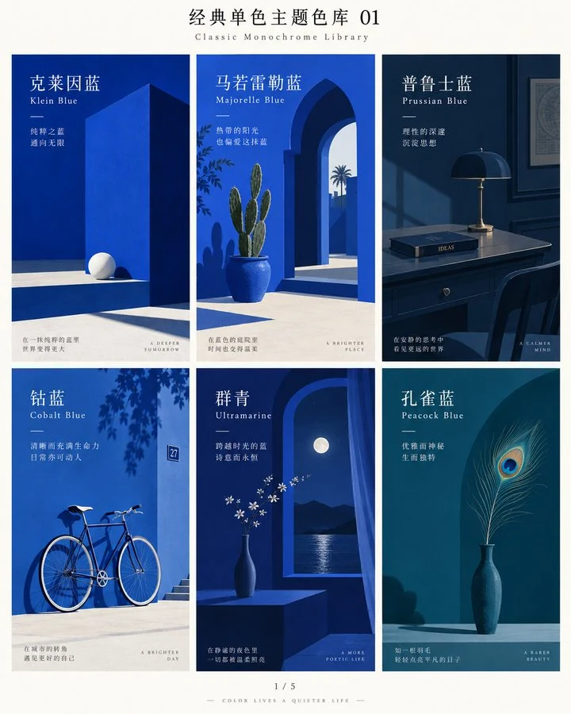

<p align="center">
  <strong>中文</strong> | <a href="README_en.md">English</a>
</p>

# 手绘风格与排版图型提示词库（Hand-drawn Style & Layout Prompter）

<p align="center">
  <a href="https://hellogithub.com/repository/yang0/handraw-style" target="_blank">
    
  </a>
</p>

> **不会描述画风？排不好版面构图？选个编号，一键生成极具辨识度的 AI 生图提示词。**

本项目整理了 **001–365 种手绘与写实视觉风格**、**170 种排版图型**（社媒卡、信息图、漫画分镜、IP设计、电商）与 **36 种经典单色主题色**。
不管是做小红书爆款图文、公众号题图、知识科普长图，还是绘制多格叙事条漫，你都不需要背诵复杂的画风术语，也不需要费心构思版面结构——**只要选定风格编号、排版编号与主题色，告诉 AI 你想表现的主题，就能立即获得经过实测验证的中英双语生图提示词**，直接复制到支持生图的 AI 工具中出图。

> [!NOTE]
> ### 📢 开源许可与致谢说明
> **欢迎自由使用、修改和商业化。**<br>
> 唯一的小请求：如果这个项目对你有帮助，或者你的项目基于它进行了二次开发，**请保留作者 yang0 和原仓库地址**（[https://github.com/yang0/handraw-style](https://github.com/yang0/handraw-style)）。开源不易，感谢你的理解与支持！

> [!TIP]
> ### 📚 官方飞书知识库已上线
> 🔗 **[👉 点击进入官方飞书知识库 ↗](https://ecmn3m3i17.feishu.cn/wiki/space/7689222460876524523?ccm_open_type=lark_wiki_spaceLink&open_tab_from=wiki_home)**
> 
> 1. 🖼️ **速查画廊**：移动端与网页端秒级检索 365 种视觉风格与 170 种排版效果大图
> 2. ❓ **Skill 常见问题与提示词速查**：安装配置、出图答疑、常见生图报错排查与经典提示词模版
> 3. 💡 **创业与变现经验**：持续更新社群创作者分享的一线实操变现案例与商业探索心得

---

## 🌟 核心解决的问题与特色

| 创作痛点 | 本库的解决方案 |
| :--- | :--- |
| **画风描述模糊，每次生成都漂移** | **编号化精准激活**：365 种手绘插画与写实摄影风格体系（支持 FA~FI 分类编号与 001–365 传统编号），告别“可爱一点、文艺一点”的玄学生图。 |
| **版式构图单调，排不好社媒长图** | **170 种排版图型**：24 种社媒卡、38 种数据信息图、71 种漫画分镜、13 种IP设计、24 种电商图型，构图版式开箱即用。 |
| **色彩杂乱，缺乏统领画面的基调** | **36 种经典单色库**：克莱因蓝、鼠尾草绿、爱马仕橙、佩恩灰等，一键赋予画面高级纯正色调。 |
| **图文不搭，文字塞不进画面** | **双模式随心切换**：支持“纯图模式”（纯插画表现）与“图文模式”（文字与画面一体化构图）。 |
| **模型画风锁死或无法识别** | **模型能力分层与兜底**：显式模型精准标定（关键词/特征激发），通用与第三方模型自动参考图兜底保真。 |
| **文章封面难出彩，文案画面脱节** | **文章与视频封面设计器**：根据全文或视频字幕自动提炼 200 字摘要与受众画像，匹配风格色彩，先隐喻后出图，视频封面自动注入吸睛网感指令。 |
| **长文插图风格杂乱，手动排版繁琐** | **长文配图规划与自动回填**：编辑级视觉点位决策，全篇单画风单色调统一，支持一键批量生图并排版回填 Markdown。 |
| **影楼摄影企划繁杂，AI 人像出图难控** | **专业摄影与时空企划编排**：支持情侣、婚纱、写真、全家福等 10+ 拍摄类型，首轮出齐 3 个高差异时空方案（带 8 宫格提示词代码块），一键复制自行出图或选定直出，拒绝泛 AI 感。 |

## 🎯 适用人群与场景

- **自媒体创作者**：小红书爆款封面与图文、公众号题图、朋友圈精选海报
- **公众号与深度长文作者**：长文核心摘要提炼、高点击封面设计、全篇风格统一的批量插图规划与 Markdown 自动回填
- **摄影爱好者与人像创作者**：情侣写真、婚纱样片、亲子全家福、古风汉服等 10+ 题材的专业时空分镜编排与 8 宫格样片快速出图
- **知识科普博主**：对比清单、架构金字塔、步骤流程等高传播信息长图
- **条漫与故事创作者**：四格故事、多格情绪条漫、剧情分镜脚本、绘本插图
- **视觉与品牌设计师**：快速输出高调性手绘草图、创意活动海报与插画原型

## 安装

直接把本仓库地址发给 Codex，让 Codex 自动完成安装：

> **“帮我安装这个 Skill：https://github.com/yang0/handraw-style”**

Codex 会自动拉取仓库并配置好全部风格与排版资源。

本项目聚焦手绘图片、封面、插图、IP、电商和摄影设计。视频制作、配音、分镜画廊和渲染已拆到独立的 `handraw-video` 项目，不再随图片 Skill 安装；视频封面设计作为静态图片能力保留。

其他功能的包内资源、运行工具与在线服务边界见[项目依赖说明](DEPENDENCIES.md)。提交前可运行`python scripts/audit_release.py`检查本机路径、常见凭据和视频文件是否混入。

本次自包含与隐私修正的范围、验证和历史提交边界见[发布检查记录](RELEASE_AUDIT.md)。

## 这个 Skill 怎么用

### 1. 智能推荐模式（零门槛：不指定编号直接出图）
如果你不想翻阅图鉴挑选编号，**直接告诉 Skill 你想画什么即可**！Skill 会自动理解主题的情绪、氛围与场景，**自动为你匹配最契合的手绘风格与经典主题色组合**（附带推荐理由），直接交付完整提示词：
- 零参数直出：`帮我生成猫咪在窗台晒太阳的治愈插画提示词，你帮我选风格和主题色（可组合）`
  > 💡 智能推荐组合：风格 `#FA-018 (#018) · Minimal Deadpan Dialogue Cartoon` + 主题色 `C-26 · 柿子橙`（理由：画面充满温暖治愈与松弛感），直接输出中英双语提示词。
- 补齐模式：若你仅指定了风格（如 `FB-006 / 041号风格，主题：秋天的第一杯奶茶`），Skill 会自动推荐最搭的主题色（如 `C-01 克莱因蓝`）；若仅指定了主题色，Skill 会自动推荐最搭的画风。

### 2. 精准指定模式（自选手绘编号、图型与主题色）
1. 打开 [风格图鉴 (STYLES.md)](STYLES.md)、[排版图鉴 (LAYOUTS.md)](LAYOUTS.md) 或 [单色图鉴 (COLORS.md)](COLORS.md)，浏览直观效果并挑选编号；
2. 记下喜欢的编号，例如风格 `FB-006`（原 `041`）、图型 `SC-001`，或主题色 `C-01`；
3. 输入指令给 Skill，例如：
   - 单独调用风格：`FB-006号风格（或 041号），主题：秋天的第一杯奶茶`
   - 组合排版与风格：`图型：SC-001，风格：FB-006，主题：秋天的第一杯奶茶`
   - 指定主题色：`图型：SC-001，风格：FB-006，主题色：C-01，主题：秋天的第一杯奶茶`
4. 得到带风格名称、版式定义与主题色限定的中英双语提示词；
5. 复制到 Midjourney、DALL-E 3、Stable Diffusion、Flux 等生图 AI 中直接出图。

### 3. AI 海报设计模式（结构化极简提示词，原生图文一体排版）
需要制作节日宣发、活动主视觉或社交媒体高调性海报？直接告诉 Skill 你的海报主题即可！
- **输入指令**：`请帮我出海报提示词， 主题：秋分`
- **智能协同**：Skill 会自动分析主题，从手绘图库中匹配最契合的画风（如 `#FE-053 (#268) · 当代人文水墨漫画`）与经典主题色（如 `主色 C-26 柿子橙 + 点缀色 C-03 普鲁士蓝`），按**8 大核心纯净设计字段**（主题、场景、受众、密度、情感、主题色、editorial风格、画风）输出提示词并附加图文一体指导规范。
- **实测出图效果**：将生成的提示词直接输入生图模型（如 GPT Image 2/2.5），AI 模型将自主完成绝妙的排版构图与字画融合——大字书法标题、诗意对联、印章、日夜均分同辉意象与松弛水墨人物浑然一体：

<p align="center">
  
  <br>
  <em>实测出图案例：#FE-053 (#268) 当代人文水墨漫画 + 主色 C-26 柿子橙 / 点缀色 C-03 普鲁士蓝</em>
</p>

<details>
<summary>👉 点击展开查看完整海报提示词</summary>

```text
主题：秋分·昼夜均而寒暑平
业务场景：二十四节气传统文化海报、文创书店/茶饮节日宣发主视觉、社媒节气签
受众：传统文化爱好者、文艺青年、生活美学追求者、大众社媒读者
内容密度：低
情感基调：松弛闲适、温润拙朴、平衡从容、金秋诗意
主题色：主色为柿子橙（Persimmon Orange），点缀色为普鲁士蓝（Prussian Blue）
editorial风格：Contemporary Literati Ink Cartoon Editorial 风格
画风：风格名称：#FE-053 (#268) · Contemporary Literati Ink Cartoon。参考作者/风格名称：当代人文水墨漫画。核心风格特征：现代生活人物、动物和日常小场景；白色或微暖纸面、大面积留白；毛笔和墨线快速画人物；线条松弛、粗细不一、枯湿自然、允许断笔和不闭合轮廓；人物高度概括、比例略笨拙，以姿态和动作表达情绪；人物是画面的主要视觉主体；场景保留少量必要元素；墨色为主，少量朱红、赭石、石绿、湖蓝局部点染；书法题字和朱红印章自然嵌入留白；整体拙朴、松弛、幽默、闲适；现代生活速写与中国写意笔墨结合。【如果主题直白包含画面元素那就按主题出图，文案由你来升华，但是不要直接描述画面。 如果主题比较概念化，那么文案和主题尽量保持一致，如果文案较长由你提炼，由你先设计画面隐喻（人类和非人类都行）再出图   。    文字参与构图，图文一体】
```
</details>

### 4. 进阶心法：万能海报思维法（把信息图当高密度海报做）
觉得现有的信息图图型不够用？**不要让固定的表格和模版框住你的表达！**
信息图的本质是一张高信息密度的视觉海报。直接告诉 Skill 你的**分段时段、核心数据、步骤与使用场景**，生图模型将原生把时间轴、实景插图、手帐便签与文字融为一体：
- **文旅出行路线**：《清迈 5 日慢游 DAY 1 导览》（分时段路线 + JJ市集/艺术村/宁曼路地标 + 泰北咖喱面与实用提醒）
- **户外装备清单**：《山系露营轻量化装包指南》（睡眠/烹饪/照明三大系统平铺展开 + 8kg 控制，工装风）
- **生活技能步骤**：《新手手冲咖啡指南》（水粉比 1:15 + 3 段注水时间轴 + 风味轮）

💡 **[👉 点击进入完整实战技巧与进阶教程 (TUTORIALS.md)](TUTORIALS.md)**（涵盖万能海报思维法、智能推荐机制、三元精准组装法、纯图/图文双模式与跨模型垫图策略等 5 大核心技巧与实战案例）。

### 5. 文章与视频封面设计模式（提炼摘要、受众推算、视觉隐喻与网感吸睛封面）
写完文章或剪完视频不知道怎么配一张高点击、有调性的封面？直接把文章或字幕文件发给 Skill 即可！
- **适用场景**：微信公众号文章封面（首选 `2.35:1` 或 `21:9`）、X/Twitter 文章封面（`5:2`）、小红书封面（`3:4`）、视频封面/B站/YouTube/短视频封面（横屏 `16:9`，竖屏 `9:16` 或 `3:4`）。
- **输入指令**：
  - 文章：`请根据这篇文章帮我设计封面：[粘贴文章全文或提供本地文章路径 d:\path\to\article.md]`
  - 视频/字幕：`请帮我设计视频封面：[粘贴字幕文本或输入 .srt/.vtt 字幕文件路径]`
- **自动化工作流**：
  1. **提炼核心摘要**：自动提炼 200 字左右的核心论点、剧情主线与认知启示；
  2. **推算受众画像**：结合知识深度与诉求，输出精准读者/观众画像；
  3. **注入风格与色彩**：从全库 365 种视觉风格与 36 种经典配色中匹配最契合的组合（如风格 `#FA-018 (#018) · Minimal Deadpan Dialogue Cartoon` + 主题色 `C-01 经典蓝`）；
  4. **原生隐喻与吸睛指令**：
     - 文章封面：注入核心指令——*“先设计隐喻再出图，主标题明显，小字少或者没有小字。其他你帮我设计。”* 让生图模型自主完成高质量版式与视觉隐喻构图；
     - 视频封面/字幕输入：强制注入——*“视频封面设计，网感强，吸引人眼球。先设计隐喻再出图，主标题明显，小字少或者没有小字。其他你帮我设计。”*；
  5. **双轨交付引导**：
     - **【方式 A · 自主生图】**：复制输出的中英双语提示词，前往常用生图工具出图；
     - **【方式 B · 全自动生图】**：直接回复 **“全自动出图”**，Skill 即可自动调用生图工具直接生成高质量封面图片。

### 6. 文章批量插图与自动回填模式（长文配图规划、风格统一、自动排版）
长文干货如果全篇都是密密麻麻的文字，读者很容易疲劳流失；但手动到处找图不仅风格割裂，排版还费时费力。本模式提供从**“视觉脉络规划 → 全文风格统领 → 批量生图 → 自动排版回填”**的一站式解决方案：
- **输入指令**：`请帮我为这篇文章规划插图并完成配图：[粘贴文章全文或提供本地文章路径 d:\path\to\article.md]`
- **自动化工作流**：
  1. **编辑级视觉点位决策（Visual Editorial Judgment）**：拒绝机械式段落塞图，深度理解文章论证逻辑与情绪流转，在最能产生视觉共鸣的关键拐点（开篇立意、抽象隐喻、概念解析、流程推演、收尾升华）规划 2–5 处核心配图点位；
  2. **全篇单风格与单色调统一**：整篇文章固定锁定同一套手绘风格编号（如 `#FC-029 (#276) · 当代水墨`）与主题色（如 `C-01 · 克莱因蓝`），统一采用适合长文阅读流的 `4:3` 比例（支持自定义留白度：正常/适中/多），彻底杜绝全篇图片画风混乱的问题；
  3. **标准结构化插图方案**：明确标注每张插图的【插入锚点】、【配图定位】、【图片类型】（editorial illustration / conceptual diagram / metaphorical illustration 等）、【视觉构思】与中英双语生图提示词；
  4. **双轨交付闭环**：
     - **【方式 A · 自主生图回填】**：复制提示词自行出图后，把生成的图片拖入对话或发回本地路径，Skill 会自动把图片精准插入到文章对应段落后；
     - **【方式 B · 全自动生图插入】**：直接回复 **“全自动生图”**，Skill 将全自动批量生成整套插图，并调用内置自动化排版引擎精准插入原文章，一键输出排版完毕的 Markdown 定稿文件（如 `article_illustrated.md`）。

### 7. 专业摄影写真企划模式（情侣/婚纱/写真/全家福，3候选方案与8宫格极简出图）
告别千篇一律的普通游客照与泛 AI 感人像！无论是情侣、婚纱、个人写真、亲子全家福、古风汉服，还是职场肖像与旅行抓拍，系统按专业影楼样片与 Editorial 杂志级标准进行时空与视觉编排：
- **适用场景**：情侣摄影、婚纱企划、个人写真、亲子全家福、古风汉服、新中式、复古港风、Cosplay、旅行抓拍、职场肖像等 10+ 拍摄类型。
- **输入指令**：
  `摄影写真模式，请先出3个方案供我挑选，拍摄类型：情侣`
  *(亦可在网页画廊 [tutorials.html](skills/handdraw-style-prompter/gallery/tutorials.html) 中切换到「摄影」模式，点选拍摄类型标签；主题为选填项，不填由 AI 自由发挥)*
- **自动化工作流与核心特色**：
  1. **第一步绝不擅自选定**：严格推荐 3 个具有明显地域跨度与世界观差异的候选方案（2 个现代真实世界著名地标 + 1 个穿越/古代/未来/虚构作品方案）；
  2. **逐人造型与妆发定稿**：全方位规划人物关系描述、独立逐人服装穿搭、Editorial 发型师与化妆师定稿（女性默认影楼柔焦精修质感，保留真实皮肤质感与自然光影）；
  3. **独立代码块与 8 宫格关键词**：3 个方案分别完整封装在独立代码片段（` ```text `）中，末尾直接附加出图关键词 `出8宫格图片。`；
  4. **极简出图双体验**：
     - **【一键复制自行出图】**：点击任意代码块右上角一键复制完整提示词，直接粘贴到 Midjourney、Flux 或其他生图模型自行出图；
     - **【回复 A/B/C 直接出图】**：在对话中直接回复 `A`、`B` 或 `C`，AI 即刻基于该方案执行 8 宫格图片生成，彻底跳过冗长繁琐的方案计划等待！

## 两种模式，随时切换

同一个编号和主题可以随时在两种模式之间切换，无需重新选择风格。

- **纯图模式**：让主题决定画面内容，适合只需要插画、不需要画中文字的场景。示例：`纯图模式，FB-006 (041)号风格，主题：秋天的第一杯奶茶`。
- **图文模式**：保留你写下的主题原文，让文字参与画面构图，适合金句、海报与社交媒体配图。示例：`图文模式，FE-052 (267)号风格，主题：有很多事你当时想不通，别着急，过段时间你可能就忘了。`。

切换时直接说“切换为纯图模式”或“切换为图文模式”即可；不指定时默认使用纯图模式。

### 图文模式演示

下图展示了文字与插图共同构图的效果；它仅作为图文模式演示，不绑定任何编号风格。


### 模型适配机制说明

Skill 默认只负责把想法变成提示词；你明确要求“生图”时，会根据模型的已知能力决策最适合的生成策略：

- **显式标定模型（首发深度适配 `gpt-image-2`）**：建立了全量风格的激活能力清单。生图优先级为：作者名称 + 风格名称 → 注入正向核心风格特征 → 仅在特征不足或难以激活时才传参考图，避免无谓传图导致主体构图被锁死。这个判断基于实际盲测，与作者是否著名无关。
- **通用模型与未标定模型（如 Midjourney、Flux、Stable Diffusion、Imagen、Gemini 等）**：采用经过实测最稳妥的**“参考图高保真兜底（Reference Image Fallback）”**策略。系统会自动提供 4-grid 标准参考垫图或单图指引，确保即使在未深度标定关键词能力的模型中，也能 100% 忠实还原该编号对应的线条、质感与配色风格。
- **欢迎社区共建**：能力矩阵定义在 `skills/handdraw-style-prompter/references/model_capabilities.json` 中，结构透明开放，欢迎社区提交更多生图模型的实测激活评测数据！

## 三个例子

```text
FB-006 (041)号风格，主题：秋天的第一杯奶茶
FE-041 (210)号风格，主题：小男孩在雪地里点鞭炮
FH-039 (193)号风格，主题：大唐夜宴
```

## 风格精选预览

这里展示了手绘风格的精选预览拼图（FA-001–FA-016，原 001–016）：



- 🖼️ **[👉 查看更多手绘与写实风格图片（368 种完整风格拼图大表，支持 FA~FI / 001–368 检索）](STYLES.md)**
- 📄 **[查看风格详细参数表（368 种风格 Markdown 详细表格与特征描述）](styles_200_reorganized.md)**
- 💻 *（本地离线使用：可在本地浏览器打开 `skills/handdraw-style-prompter/gallery/index.html` 交互检索与放大）*

## 排版图型展示

除了丰富的手绘风格，本库还收录了 **170 种排版图型**，涵盖社交卡片、数据长图、分镜故事、IP设计与电商，支持一键组合风格与排版出图。

### 1. 社媒卡（Social Cards · 21 种）

适合小红书、朋友圈、公众号配图及观点金句卡片，结构包含上下图文、文案主导、双格对照、签名展示等。



👉 **[查看更多社媒卡图型（21 种完整图鉴与排版提示词）](LAYOUTS.md#social-cards)**

---

### 2. 信息图（Infographics · 35 种）

适合知识科普、对比清单、流程步骤及数据展示，结构包含金字塔层级、中心主图标注、多行多列对比等。



👉 **[查看更多信息图图型（35 种完整图鉴与排版提示词）](LAYOUTS.md#infographics)**

---

### 3. 漫画分镜（Comic Storyboards · 68 种）

适合多格叙事、条漫剧情、情绪递进及动态视觉，包含规则四格、起承转合、大格冲击、对角切割等专业分镜。



👉 **[查看更多漫画分镜图型（68 种完整图鉴与排版提示词）](LAYOUTS.md#comic-storyboards)**

---

### 4. IP设计（IP Design · 13 种）

适合品牌 IP 策划、角色设定、情绪定位与商业衍生，打造高辨识度吉祥物与品牌形象封面。

👉 **[查看 IP 设计图型（13 种完整图鉴与排版提示词）](LAYOUTS.md#ip-characters)**

---

### 5. 电商（E-commerce · 24 种）

适合电商单品主图、多视角、局部细节特写、包装套装、卖点标注、参数尺寸、材质解析、选购决策、工艺说明、数据证明、口碑评价、品牌故事、新品上市、促销活动、内容种草及广告主视觉等高转化商业构图。

👉 **[查看电商图型（24 种完整图鉴与排版提示词）](LAYOUTS.md#ecommerce)**

---

- 💡 **[👉 进入排版图型完整图鉴，浏览全部 170 种排版与提示词 ↗](LAYOUTS.md)**
- 💻 *（本地离线使用：可在本地浏览器打开 `skills/handdraw-style-prompter/gallery/layouts.html` 交互检索与放大）*

---

## 经典单色主题色展示（36 种）

本项目精选并提炼了 **36 种经典单色主题色**（编号 `C-01` ~ `C-36`，涵盖经典蓝系、清新绿系、古典红绿、浪漫粉紫、暖阳大地、中性色系 6 大色系）。
无论搭配何种手绘风格与排版结构，只需指定主题色编号，即可统领整张画面的色彩基调；也可在画廊中直接一键复制单色提示词。



- 🎨 **[👉 进入经典单色主题色完整图鉴，浏览全部 36 种单色与提示词 ↗](COLORS.md)**
- 💻 *（本地离线使用：可在本地浏览器打开 `skills/handdraw-style-prompter/gallery/colors.html` 一键复制中英提示词与交互预览）*

---

## 作者与社群交流

- 📚 **官方飞书知识库**：[点击访问知识库（速查画廊 / 常见问题速查 / 创业变现案例） ↗](https://ecmn3m3i17.feishu.cn/wiki/space/7689222460876524523?ccm_open_type=lark_wiki_spaceLink&open_tab_from=wiki_home)
- **创作变现交流群 / 作者微信**：请优先加群，满了的话也可以尝试加我个人微信。请备注：**手绘**

| ① 优先加入群聊（手绘10群） | ② 个人微信（备用） |
| :---: | :---: |
|  |  |

- X：[@yang02010](https://x.com/yang02010)

---

## 📄 开源许可协议 (License)

本项目采用宽松且附带署名要求的开源协议。**欢迎自由使用、修改和商业化。**

唯一的小请求：如果这个项目对你有帮助，或者你的项目基于它进行了二次开发，请保留作者 **yang0** 和原仓库地址：[https://github.com/yang0/handraw-style](https://github.com/yang0/handraw-style)。

完整许可协议详见 [LICENSE](LICENSE)。
