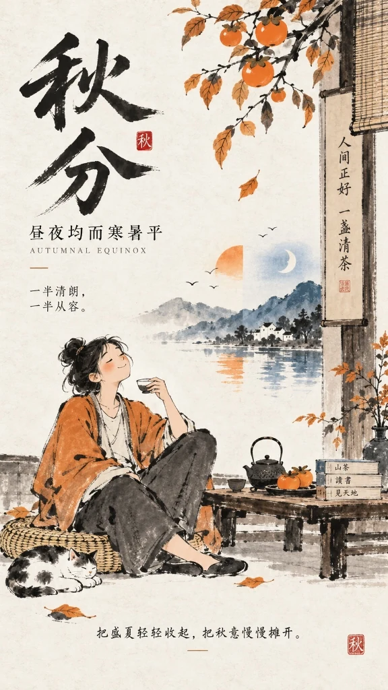
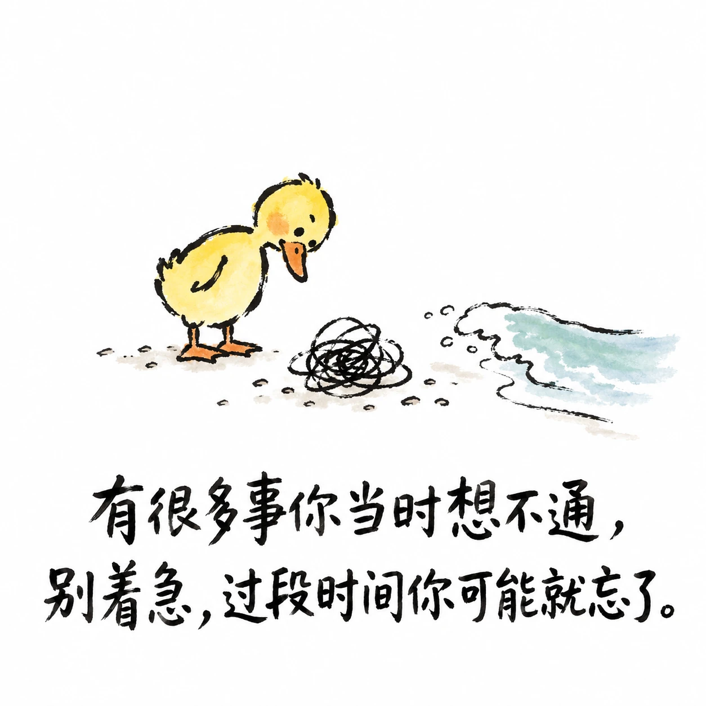
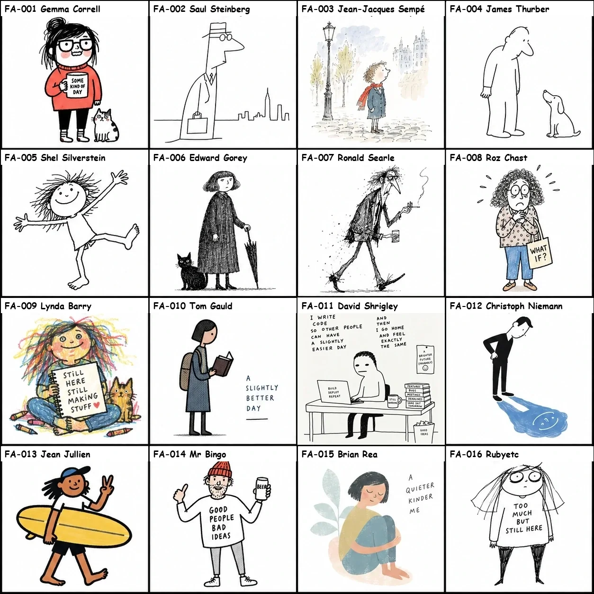
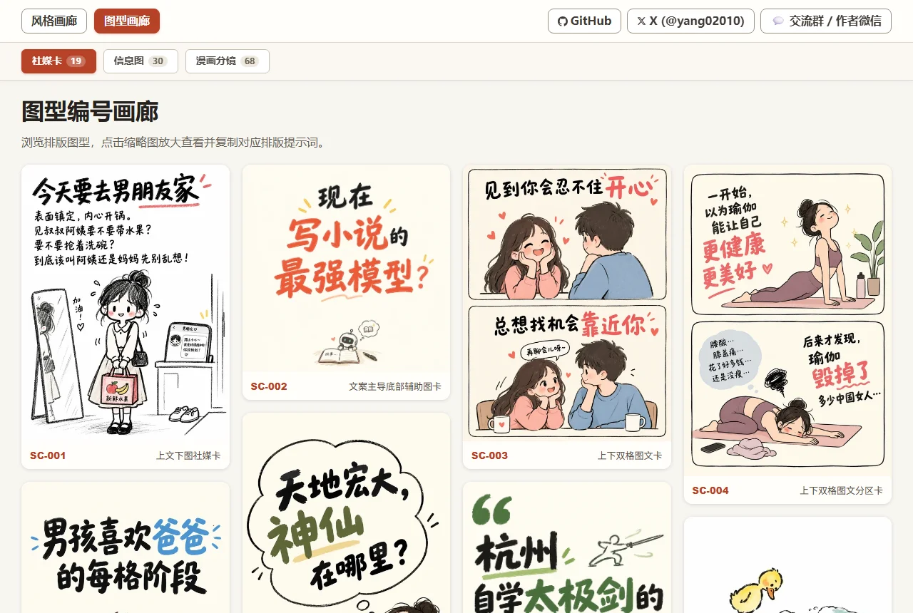
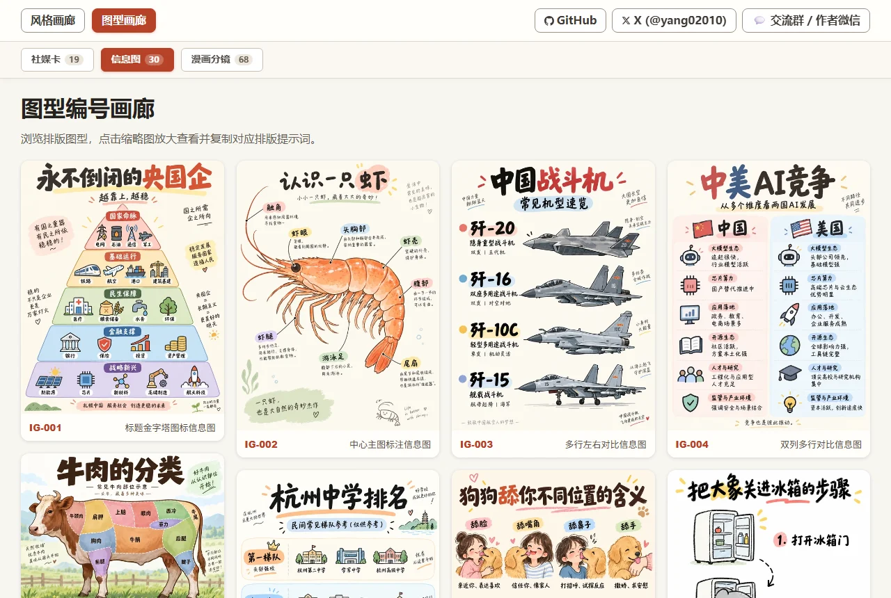
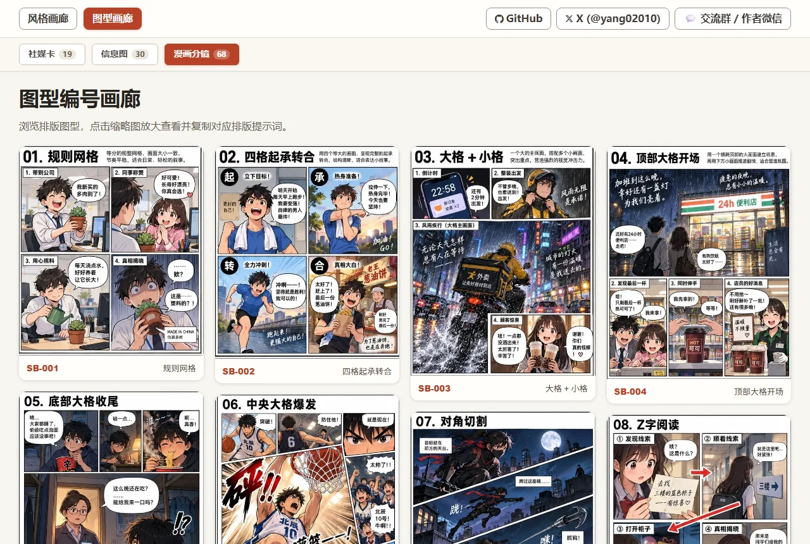
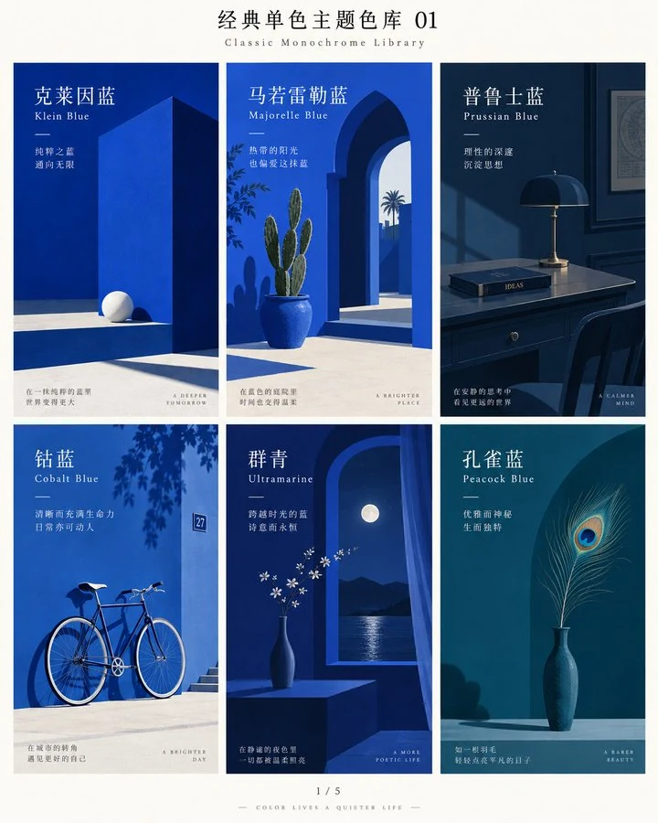

<p align="center">
  <a href="README.md">中文</a> | <strong>English</strong>
</p>

# Hand-drawn Style & Layout Prompter for AI Image Generation

<p align="center">
  <a href="https://hellogithub.com/repository/yang0/handraw-style" target="_blank">
    
  </a>
</p>

> **Struggling to describe art styles? Trouble structuring visual layouts? Simply pick an index number to generate highly recognizable AI image prompts.**

This repository curates **365 distinct hand-drawn and realistic visual styles** (supporting both `FA`~`FI` category IDs and legacy `001`–`368`), **170 composition layout patterns** (`SC-*` Social Cards, `IG-*` Infographics, `SB-*` Comic Storyboards, `IP-*` IP Design, `EC-*` E-commerce), and **36 curated classic monochrome colors** (`C-01`–`C-36`).

Whether you are crafting social media post covers, educational infographics, architectural comparisons, or multi-panel narrative comics, you no longer need to memorize obscure art history terminology or struggle with complex compositions. **Simply choose a style number, layout ID, and theme color, supply your topic, and instantly get verified, high-fidelity bilingual prompts ready to paste into Midjourney, DALL-E 3, Flux, Stable Diffusion, or any other image generator.**

> [!NOTE]
> ### 📢 Open Source & Attribution Notice
> **You are welcome to freely use, modify, and commercialize this project.**<br>
> The only small request: if this project helps you, or if your project is based on secondary development of this work, **please retain author yang0 and the original repository link** ([https://github.com/yang0/handraw-style](https://github.com/yang0/handraw-style)). Thank you for your support and respect for open source!

> [!TIP]
> ### 📚 Official Feishu Knowledge Base is Live
> 🔗 **[👉 Click to Access Feishu Knowledge Base ↗](https://ecmn3m3i17.feishu.cn/wiki/space/7689222460876524523?ccm_open_type=lark_wiki_spaceLink&open_tab_from=wiki_home)**
> 
> 1. 🖼️ **Quick Visual Gallery**: Instant mobile & desktop browsing of all 365 styles and 170 layouts
> 2. ❓ **Skill FAQ & Prompt Cheat Sheet**: Setup walkthroughs, troubleshooting tips, and ready-to-use prompt patterns
> 3. 💡 **Entrepreneurship & Monetization**: Continuously updated real-world case studies and revenue strategies shared by the community

---

## 🌟 Core Pain Points & Solutions

| Creator Pain Point | How This Library Solves It |
| :--- | :--- |
| **Vague style descriptions lead to style drift** | **Numbered Indexing**: 368 systematically categorized visual styles (dual-indexed by FA~FI categories and 001–368), eliminating guess-and-pray prompting. |
| **Monotonous composition; hard to format complex graphics** | **170 Layout Compositions**: 24 Social Cards, 38 Infographics, 71 Comic Storyboards, 13 IP Design, 24 E-commerce ready out-of-the-box. |
| **Chaotic color palettes lack a cohesive tonal mood** | **36 Curated Monochrome Colors**: Klein Blue, Sage Green, Hermes Orange, Payne's Grey, etc., setting pure and sophisticated tones with one click. |
| **Text disconnects from art; awkward typography placement** | **Dual-Mode Workflow**: Seamlessly toggle between "Pure-Image Mode" (pure illustration) and "Graphic-Text Mode" (unified visual-textual composition). |
| **Models ignore style keywords or lack style fidelity** | **Tiered Model Adaptation & Fallback**: Calibrated keyword activation for native models; automatic Reference Image Fallback (4-grid sheets) for all third-party models. |
| **Boring article covers with disconnected visuals** | **Article & Video Cover Designer**: Automatically extracts ~200-word core summary & audience persona from articles or video subtitles, matches styles & colors, prioritizes visual metaphor, and injects viral click-worthy directives for video covers. |
| **Inconsistent article illustrations & tedious formatting** | **Article Illustration Planner & Backfill**: Visual editorial judgment for 2–5 high-value inflection points, unified single style & color across the piece, automated batch image generation, and precision Markdown insertion. |
| **Chaotic photo shoot planning & generic AI portraits** | **Editorial Photography & Spacetime Orchestration**: Supports 10+ genres (couples, weddings, portraits, families, etc.), proposing 3 high-contrast spacetime plans in copyable code blocks with 8-grid keywords for one-click generation. |

---

## 🎯 Target Audiences & Use Cases

- **Content Creators & Influencers**: Social media covers (Xiaohongshu, Instagram, X/Twitter), newsletter hero images, viral quote cards.
- **Newsletter & In-Depth Article Writers**: Automatic ~200-word argument extraction, high-converting cover design, cohesive multi-illustration planning, and automated Markdown insertion.
- **Photographers & Portrait Creators**: Editorial studio planning for 10+ genres (couples, weddings, family portraits, Hanfu, etc.) with instant 8-grid sample generation.
- **Knowledge & Tech Bloggers**: Comparison lists, architecture pyramids, step-by-step processes, and high-engagement infographics.
- **Comic & Story Creators**: 4-panel strips, emotional webtoons, storyboard drafts, children's storybook illustrations.
- **Visual & Brand Designers**: Rapid concept sketching, creative campaign posters, character design prototypes.

---

## Installation

You can install this skill directly into your AI coding assistant (Codex, Claude Code, Cursor, WorkBuddy, OpenCode):

> **"Install this Skill for me: https://github.com/yang0/handraw-style"**

The assistant will automatically clone the repository and configure all styles, layout templates, and reference assets.

This package focuses on static image design. Video production, narration, rendering and the shot gallery now belong to the separate `handraw-video` project. Static video-cover design remains available here.

---

## How to Use This Skill

### 1. Smart Recommendation Mode (Zero Friction: No IDs Required)
If you don't want to browse through indexes, **simply describe what you want to illustrate**! The Skill analyzes your theme's mood, domain, and context, then **automatically pairs the best-matching hand-drawn style with an optimal classic monochrome theme color** (including an aesthetic rationale):
- *Zero-parameter prompt*: `Generate a prompt for a healing illustration of a cat sunbathing on a windowsill, pick the style and theme color for me (can combine)`
  > 💡 *Recommended Pairing*: Style `#FA-018 (#018) · Minimal Deadpan Dialogue Cartoon` + Color `C-26 · Persimmon Orange` (Rationale: warm, comforting, and relaxed atmosphere), outputting production-ready bilingual prompts immediately.
- *Completion*: If you specify only a style (e.g., `Style FC-029 / 276, Theme: Future of AI`), the Skill auto-recommends a harmonious color (e.g., `C-01 Klein Blue`). If you specify only a color, it auto-recommends a fitting style.

### 2. Precise Manual Selection Mode (Choose Specific IDs)
1. Open the [Style Visual Sheet (STYLES_en.md)](STYLES_en.md), [Layout Visual Sheet (LAYOUTS_en.md)](LAYOUTS_en.md), or [Classic Monochrome Colors Sheet (COLORS_en.md)](COLORS_en.md) to browse visual sheets and pick your desired numbers;
2. Note your chosen ID, such as style `FB-006` (or legacy `041`), layout `SC-001`, or theme color `C-01`;
3. Send your prompt command to the Skill, for example:
   - **Style only**: `Style: FB-006 (041), Theme: First milk tea of autumn`
   - **Layout + Style**: `Layout: SC-001, Style: FB-006 (041), Theme: First milk tea of autumn`
   - **With Theme Color**: `Layout: SC-001, Style: FB-006 (041), Color: C-01, Theme: First milk tea of autumn`
4. Receive clean, copyable bilingual prompts with precise style definitions, layout geometry, and unified color palette;
5. Copy and paste into Midjourney, DALL-E 3, Stable Diffusion, Flux, or any image generator to create your artwork.

### 3. AI Poster Design Mode (Structured Prompts, Native Integrated Layout)
Need to design festival campaign visuals, key art, or editorial social media posters? Simply tell the Skill your poster theme!
- **Prompt Command**: `请帮我出海报提示词， 主题：秋分` (or `Generate a poster prompt for me, Theme: Autumn Equinox`)
- **Intelligent Synergy**: The Skill analyzes the concept and pairs the best-matching hand-drawn style (e.g., `#FE-053 (#268) · Contemporary Literati Ink Cartoon`) with classic theme colors (e.g., `Dominant: C-26 Persimmon Orange + Accent: C-03 Prussian Blue`). It outputs clean, structured prompts across **8 core design dimensions** (Theme, Scene, Audience, Density, Mood, Palette, Editorial Style, Hand-Drawn Style) with typography-composition integration guidelines.
- **Real Generation Showcase**: Passing the prompt directly to an image generation model (e.g., GPT Image 2/2.5) yields seamless native typographic layout and artistic metaphor fusion—large-character calligraphy title, poetic couplet inscriptions, seal stamps, balanced day-and-night imagery, and relaxed literati ink brushwork:

<p align="center">
  
  <br>
  <em>Real Generation Case: Style #FE-053 (#268) Contemporary Literati Ink Cartoon + C-26 Persimmon Orange (Dominant) / C-03 Prussian Blue (Accent)</em>
</p>

<details>
<summary>👉 Click to view the full poster design prompt</summary>

```text
主题：秋分·昼夜均而寒暑平
业务场景：二十四节气传统文化海报、文创书店/茶饮节日宣发主视觉、社媒节气签
受众：传统文化爱好者、文艺青年、生活美学追求者、大众社媒读者
内容密度：低
情感基调：松弛闲适、温润拙朴、平衡从容、金秋诗意
主题色：主色为柿子橙（Persimmon Orange），点缀色为普鲁士蓝（Prussian Blue）
editorial风格：Contemporary Literati Ink Cartoon Editorial 风格
画风：风格名称：#FE-053 (#268) · Contemporary Literati Ink Cartoon。参考作者/风格名称：当代人文水墨漫画。核心风格特征：现代生活人物、动物和日常小场景；白色或微暖纸面、大面积留白；毛笔和墨线快速画人物；线条松弛、粗细不一、枯湿自然、允许断笔和不闭合轮廓；人物高度概括、比例略笨拙，以姿态和动作表达情绪；人物是画面的主要视觉主体；场景保留少量必要元素；墨色为主，少量朱红、赭石、石绿、湖蓝局部点染；书法题字和朱红印章自然嵌入留白；整体拙朴、松弛、幽默、闲适；现代生活速写与中国写意笔墨结合。【如果主题直白包含画面元素那就按主题出图，文案由你来升华，但是不要直接描述画面。 如果主题比较概念化，那么文案和主题尽量保持一致，如果文案较长由你提炼，由你先设计画面隐喻（人类和非人类都行）再出图   。    文字参与构图，图文一体】
```
</details>

### 4. Pro Tips: The Universal Poster Mindset (Treat Infographics as High-Density Posters)
Feeling constrained by pre-canned infographic layouts? **Don't let rigid grids trap your imagination!**
The essence of an infographic is an information-dense visual poster. Simply tell the Skill your **time slots, core metrics, steps, and usage scenarios**; the model natively weaves timeline nodes, scenery illustrations, and typography into a cohesive editorial layout:
- **Travel Itineraries**: *Chiang Mai 5-Day Roaming (Day 1 Itinerary)* (Timed routes + landmarks + Northern Thai cuisine & tips)
- **Outdoor Gear Guides**: *Ultralight Mountain Camping Packing Guide* (3 core systems knolling lay flat + 8kg limit, workwear style)
- **Lifestyle Skills**: *Beginner Pour-Over Coffee Guide* (1:15 ratio + 3-stage pulse pouring timeline + flavor wheel)

💡 **[👉 Click to read the full Tutorials & Pro Tips Guide (TUTORIALS_en.md)](TUTORIALS_en.md)** (Covers the Universal Poster Mindset, Dynamic Recommendation, Triad Assembly, Dual-Mode Switching, and Multi-Model Tiering with complete copyable prompts).

### 5. Article & Video Cover Design Mode (Summary Extraction, Audience Persona, Visual Metaphor & Viral Eye-Catching Covers)
Finished writing an article or editing a video and need a high-CTR, tasteful cover? Simply send your text or subtitle file to the Skill!
- **Target Scenarios**: WeChat Official Account covers (recommended `2.35:1` or `21:9`), X/Twitter article covers (`5:2`), Xiaohongshu covers (`3:4`), Video covers / Bilibili / YouTube / Short video covers (landscape `16:9`, portrait `9:16` or `3:4`).
- **Prompt Commands**:
  - Article: `Please design a cover for this article: [paste article text or provide local file path d:\path\to\article.md]`
  - Video/Subtitles: `Please design a video cover: [paste subtitle text or provide .srt/.vtt file path]`
- **Automated Workflow**:
  1. **Core Summary Extraction**: Distills a ~200-word essence of key arguments, narrative hooks, and takeaways;
  2. **Audience Persona Inference**: Evaluates knowledge depth and motivation to construct target audience profile;
   3. **Style & Color Pairing**: Recommends the optimal match from 365 visual styles and 36 classic monochrome palettes (e.g., `#FA-018 (#018) Minimal Deadpan Dialogue Cartoon` + `C-01 Klein Blue`);
   4. **Native Metaphor & Viral Directives**:
      - Article Covers: Injects the proven editorial instruction—*"Design a visual metaphor first, then generate the image. Ensure the main title is bold and prominent, with few or no small text. Pick the rest of the design for me."*;
      - Video Covers / Subtitle Input: Mandatorily injects—*"Video cover design, high clickability and viral internet appeal, visually captivating and eye-catching. Design a visual metaphor first, then generate the image. Ensure the main title is bold and prominent, with few or no small text. Pick the rest of the design for me."*;
   5. **Dual-Track Delivery Guidance**:
      - **Track A (Manual Generation)**: Copy the generated bilingual prompts into your favorite image tool;
      - **Track B (Fully Automated)**: Simply reply **"Auto generate cover"**, and the Skill will call the image generation tool to produce the cover visual directly.

### 6. Article Illustration Planner & Auto-Backfill Mode (Visual Planning, Cohesive Art, Markdown Assembly)
Walls of text cause reader fatigue and drop-offs; yet hunting for stock photos leads to disjointed art styles and frustrating formatting. This mode offers an end-to-end editorial pipeline: **"Editorial Point Selection → Unified Style & Color → Batch Generation → Automated Markdown Insertion"**:
- **Prompt Command**: `Please plan and generate illustrations for this article: [paste article text or provide local file path d:\path\to\article.md]`
- **Automated Workflow**:
  1. **Visual Editorial Judgment**: Rejects robotic paragraph-by-paragraph illustration. Understands narrative tension and conceptual complexity to pinpoint 2–5 high-value inflection points (thesis statement, abstract metaphor, structural diagram, climax, or concluding takeaway);
  2. **Unified Single-Style & Single-Color Harmony**: Locks the entire article to a single hand-drawn style (e.g., `#FC-029 (#276) Contemporary Literati Ink`) and color palette (e.g., `C-01 Klein Blue`), formatted in an editorial standard `4:3` aspect ratio (with customizable whitespace: normal / moderate / generous);
  3. **Structured Plan & Prompts**: Specifies exact insertion anchor points, illustration purpose, image type (`editorial illustration`, `conceptual diagram`, `metaphorical illustration`, etc.), visual concept, and ready-to-use bilingual prompts;
  4. **Dual-Track Delivery Closed Loop**:
     - **Track A (Manual Generation & Backfill)**: Generate images with your preferred tool, then paste them or provide local paths; the Skill automatically inserts them after the correct anchor paragraphs in Markdown;
     - **Track B (Fully Automated Generation & Insertion)**: Simply say **"Auto generate and insert"**; the Skill sequentially generates all illustrations and triggers its built-in Python insertion engine to produce the completed, formatted Markdown document (e.g., `article_illustrated.md`).

### 7. Professional Photography Planning Mode (Couples/Weddings/Portraits/Families, 3 Candidate Plans & Instant 8-Grid Generation)
Say goodbye to cheap snapshot looks and generic AI portraiture! Whether planning couple sessions, wedding shoots, solo portraits, family portraits, ancient Hanfu, or travel snapshots, the system plans spacetime coordinates, styling, and cinematography to editorial studio standards:
- **Applicable Genres**: Couple photography, wedding shoots, solo portraits, family portraits, ancient Hanfu, New Chinese, vintage HK style, cosplay, travel snapshots, executive portraits, etc.
- **Prompt Command**:
  `Photography mode, please first propose 3 candidate directions for me to choose from, shoot type: couple`
  *(Or toggle to "Photography" mode in the web prompt assembler [tutorials.html](skills/handdraw-style-prompter/gallery/tutorials.html); theme is optional, AI will curate 3 diverse spacetimes if unstated)*
- **Automated Workflow & Core Highlights**:
  1. **Strict 3-Option Proposal First**: Proposes 3 candidate directions with dramatic geographical and worldview contrast (2 modern real-world landmarks + 1 time-travel / historical / future / fictional universe); never automatically decides for the user;
  2. **Per-Participant Styling & Makeup Decisions**: Details participant relationships, individual distinct wardrobes, and finalized Editorial hair & makeup (female subjects default to soft-focus studio retouch, preserving authentic skin texture and natural lighting);
  3. **Self-Contained Code Blocks with 8-Grid Keywords**: All 3 plans are fully encapsulated inside independent text code blocks (` ```text `) ending with the generation keyword `出8宫格图片。`;
  4. **Flexible Dual-Track Generation**:
     - **【One-Click Copy & Generate】**: Click the copy button on any code block to grab the full prompt, then paste into Midjourney, Flux, or any image generator;
     - **【Reply A / B / C for Instant Generation】**: Reply `A`, `B`, or `C` in chat, and the AI immediately generates the 8-grid sample image for that direction without waiting through tedious planning documents!

---

## Two Prompt Modes, Instant Switching

Any number and theme can seamlessly toggle between two modes without changing your style:

- **Pure-Image Mode (纯图模式)**: Let the theme dictate pure pictorial content without in-image text. Ideal for pure illustrations, wallpapers, book covers, and concept art.  
  *Example*: `Pure-image mode, Style: FB-006 (041), Theme: First milk tea of autumn`
- **Graphic-Text Mode (图文模式)**: Preserves your copy text and guides the AI to design metaphors and integrate typography harmoniously into the visual composition. Ideal for quote posters, meme graphics, and social cards.  
  *Example*: `Graphic-text mode, Style: FE-052 (267), Theme: There are many things you couldn't figure out back then. Don't worry, give it some time and you might just forget about them.`

Switch modes anytime by typing *"switch to pure-image mode"* or *"switch to graphic-text mode"*. Defaults to pure-image mode when unstated.

### Graphic-Text Mode Demonstration

The illustration below shows text integrated harmoniously with the visual composition (this is a conceptual demonstration and not tied to any single number):



---

### Model Adaptation Mechanism

By default, the Skill crafts copyable prompts. When you explicitly request image generation, it optimizes the output based on verified model capabilities:

- **Explicitly Calibrated Models (e.g., `gpt-image-2`)**: Full activation hierarchy for all 368 styles: Style/Author Name → Positive Core Traits → Reference Image only when traits alone cannot reliably trigger the style, avoiding unnecessary image passing that might over-constrain the composition.
- **Third-Party & General Models (Midjourney, Flux, Stable Diffusion, Imagen, Gemini, etc.)**: Employs the rock-solid **Reference Image Fallback** strategy. The Skill provides a 1024x1024 4-grid standard reference image or file path, ensuring 100% faithful reproduction of linework, texture, and color palette without prompt drift.
- **Open for Community Benchmarks**: Capability definitions reside in `skills/handdraw-style-prompter/references/model_capabilities.json`. Pull requests for other model evaluations are warmly welcomed!

---

## Three Quick Examples

```text
Style: FB-006 (041), Theme: First milk tea of autumn
Style: FE-041 (210), Theme: Little boy lighting firecrackers in the snow
Style: FH-039 (193), Theme: Tang Dynasty Night Banquet
```

---

## Featured Styles Preview

Here is a contact sheet preview of featured hand-drawn illustration styles (FA-001–FA-016, formerly 001–368):



- 🖼️ **[👉 Browse All Style Sheets (368 Styles Visual Contact Sheets, indexed by FA~FI / 001–368)](STYLES_en.md)**
- 📄 **[View Detailed Style Metadata (368 Styles Table & Core Traits)](styles_200_reorganized.md)**
- 💻 *(For offline interactive search and enlargement, open `skills/handdraw-style-prompter/gallery/index.html` in your local browser)*

---

## Layout Compositions Showcase

In addition to 365 illustration and realistic visual styles, this library includes **170 composition layout patterns**, covering social cards, data infographics, multi-panel storyboards, IP design, and e-commerce. Combine any style with any layout with a single command.

### 1. Social Cards (21 Layouts)

Ideal for Xiaohongshu, Instagram, quote cards, signature showcases, and social media carousels. Includes top-bottom split, text-driven cards, two-column contrasts, signature showcase grids, and sticky notes.



👉 **[View All Social Card Layouts (21 Visuals & Prompts)](LAYOUTS_en.md#social-cards)**

---

### 2. Infographics (35 Layouts)

Ideal for knowledge breakdowns, comparison checklists, step-by-step processes, and structured data visuals. Includes hierarchy pyramids, central icons, matrices, and multi-column comparison tables.



👉 **[View All Infographic Layouts (35 Visuals & Prompts)](LAYOUTS_en.md#infographics)**

---

### 3. Comic Storyboards (68 Layouts)

Ideal for multi-panel narratives, webtoons, emotional storylines, and cinematic pacing. Includes standard 4-panel grids, dramatic wide-angle focus, diagonal cuts, and manga storyboards.



👉 **[View All Comic Storyboard Layouts (68 Visuals & Prompts)](LAYOUTS_en.md#comic-storyboards)**

---

### 4. IP Design (13 Layouts)

Ideal for brand mascot planning, character design manual, emotional positioning, and commercial derivatives.

👉 **[View IP Design Layouts (13 Visuals & Prompts)](LAYOUTS_en.md#ip-characters)**

---

### 5. E-commerce (24 Layouts)

Ideal for e-commerce single product hero shots, multi-angle views, detail closeups, packaging/sets, feature callouts, dimensions, material breakdowns, craftsmanship, certification & data, customer reviews, brand stories, new arrivals, promotional sales, UGC seeding, and advertising key visuals (KV).

👉 **[View E-commerce Layouts (24 Visuals & Prompts)](LAYOUTS_en.md#ecommerce)**

---

- 💡 **[👉 Enter Full Layout Visual Sheet to Browse All 170 Layouts & Prompts ↗](LAYOUTS_en.md)**
- 💻 *(For offline interactive search and category filtering, open `skills/handdraw-style-prompter/gallery/layouts.html` in your local browser)*

---

## Classic Monochrome Colors Showcase (36 Colors)

This library curates **36 classic monochrome theme colors** (numbered `C-01` ~ `C-36`, covering Classic Blue, Fresh Green, Vintage Red & Classical, Romantic Pink & Purple, Warm Sun & Earth, and Classic Neutral Tones).
No matter what illustration style or layout composition you choose, specifying a theme color instantly establishes a cohesive visual tone. You can also copy individual color prompts with one click in the offline gallery.



- 🎨 **[👉 Enter Classic Monochrome Colors Visual Sheet to Browse All 36 Colors & Prompts ↗](COLORS_en.md)**
- 💻 *(For offline interactive search and one-click copy, open `skills/handdraw-style-prompter/gallery/colors.html` in your local browser)*

---

## Author & Community

- 📚 **Feishu Knowledge Base**: [Access Knowledge Base (Visual Gallery / FAQ / Monetization Case Studies) ↗](https://ecmn3m3i17.feishu.cn/wiki/space/7689222460876524523?ccm_open_type=lark_wiki_spaceLink&open_tab_from=wiki_home)
- **Creator Monetization Community / Author WeChat**: Please prioritize joining the group; if full, try adding personal WeChat. Note: **handdraw**:

| ① Join Group Chat (Priority) | ② Personal WeChat (Fallback) |
| :---: | :---: |
|  |  |

- **X (Twitter)**: [@yang02010](https://x.com/yang02010)
- **GitHub**: [yang0/handraw-style](https://github.com/yang0/handraw-style)

---

## 📄 License

This project is licensed under the MIT License with an explicit attribution requirement. **You are welcome to freely use, modify, and commercialize.**

The only request: if this project is helpful to you, or if your project is based on secondary development of this work, please retain credit to author **yang0** and the original repository link: [https://github.com/yang0/handraw-style](https://github.com/yang0/handraw-style).

See [LICENSE](LICENSE) for full terms.
